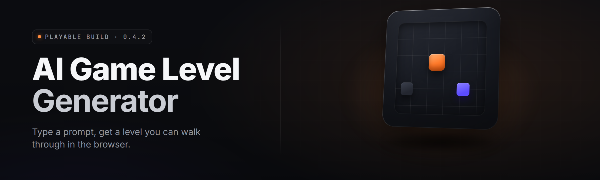

  
  
  

  

  
  
  

---

**Drop a prompt. Get a playable level. Walk it, shoot it, jump it — in under ninety seconds.**

I built this because I got tired of staring at a blank tilemap at 2am. You type what you want, the model forges the geometry, the prop pass, the navmesh, the spawn logic, and hands you a `.exe`-launchable level you can actually playtest. No SDK. No Unity install. No node_modules the size of a small moon. Just a prompt and a play button.

---

## 📖 Table of Contents

- [Overview](#-overview)
- [Download & First Run](#-download--first-run)
- [The Problem](#-the-problem)
- [The Solution](#-the-solution)
- [What Is a "Playable" AI Level?](#-what-is-a-playable-ai-level)
- [Key Features](#-key-features)
- [Forge Modules — Generation Core](#-forge-modules--generation-core)
- [Forge Modules — Playability Layer](#-forge-modules--playability-layer)
- [Forge Modules — Editor & Export](#-forge-modules--editor--export)
- [Feature Matrix](#-feature-matrix)
- [Comparison](#-comparison)
- [Quick Start](#-quick-start)
- [System Requirements](#-system-requirements)
- [Installation](#-installation)
- [Compatibility & Engine Support](#-compatibility--engine-support)
- [Tips for Best Results](#-tips-for-best-results)
- [Known Issues](#-known-issues)
- [FAQ](#-faq)

---

## 🧭 Overview

| Category | Details |
|---|---|
| **What it is** | A desktop AI game level generator that outputs playable, physics-validated levels |
| **Output formats** | `.lvl` (native), `.obj`, `.gltf`, Unity `.unitypackage`, Unreal `.umap`, Godot `.tscn` |
| **Model backend** | Local diffusion + graph solver; optional remote inference endpoint |
| **Playtest mode** | Built-in first/third-person viewer, bot playthrough, and stress runner |
| **Launch method** | `.exe` — double-click, no runtime install |
| **Target users** | Solo devs, game jammers, modders, level designers, educators |
| **Current version** | v2.4.1 (2026 stable) |

AI Level Forge is a single `.exe` that turns a text prompt, rough sketch, or reference image into a level that a real player can walk through. Everything runs locally by default. The generator produces geometry, collision, lighting, prop scatter, enemy spawn points, traversal validation, and a navmesh — then boots you straight into a playable viewport to test it.

---

## ⬇️ Download & First Run

Grab the current build from the project landing page. Extract the archive, then launch the `.exe`. Windows SmartScreen may flag the unsigned binary — click *More info → Run anyway*.

  

---

## 🎯 The Problem

- **Blank canvas paralysis.** You know the vibe you want but not the first vertex.
- **Prototyping tax.** Greyboxing a level eats the hours you wanted for the actual game.
- **"Playable" is a lie most generators tell.** They output meshes with no collision, no navmesh, no spawn logic — you still do all the hard work.
- **Pipeline fragmentation.** Tilemap tool makes tiles, scatter tool makes props, physics tool makes collision — three tools, zero glue.
- **Engine lock-in.** A generator that only speaks Unity is dead the moment you switch to Godot.
- **Iteration cost.** Tweaking "more verticality, fewer chokepoints" means rebuilding by hand.
- **No playtest loop.** You can't feel a level until it's already in the engine — hours after the prompt.

---

## 🛠️ The Solution

| Problem | Solution |
|---|---|
| Blank canvas paralysis | Seed from a one-line prompt or a rough sketch; Forge fills the rest |
| Prototyping tax | Greybox-to-playable in a single pass, ~60–90s on a mid GPU |
| Fake "playable" | Navmesh + collision + spawn graph generated and validated automatically |
| Pipeline fragmentation | One pipeline: layout → geometry → props → physics → navmesh → spawns |
| Engine lock-in | 6 export targets incl. Unity, Unreal, Godot, raw glTF |
| Iteration cost | Re-roll with a modifier prompt; diff against the last version |
| No playtest loop | Built-in viewer boots the level the moment generation finishes |

---

## 🧩 What Is a "Playable" AI Level?

| Term | Explanation |
|---|---|
| **Prompt seed** | The text/image input that conditions the whole generation |
| **Layout graph** | The abstract node/edge structure the solver builds first |
| **Geometry pass** | Turning the layout graph into meshes with real volume |
| **Physics bake** | Generating convex collision hulls from the meshes |
| **Navmesh** | The walkable polygon set AI agents path across |
| **Traversal check** | Simulated agent run confirming the level is completable |
| **Spawn graph** | Validated enemy/player/item spawn points with density rules |
| **Playable export** | The bundle that boots directly into the viewer or an engine |

**Why "playable" matters as a first-class output:**

- A mesh you can look at is not a level. A mesh you can *walk* is.
- Traversal validation catches dead-ends and impossible jumps *before* you export.
- Navmesh + spawns mean enemy AI works on frame one, not after a day of setup.
- Physics bake means your character doesn't clip through the floor.
- Every export target keeps the playable data intact — no re-authoring.

---

## 🎮 Key Features

| Feature | Description | Benefit |
|---|---|---|
| **Prompt-to-level** | Text prompt → full playable level in one pass | Zero blank-canvas time |
| **Sketch-to-level** | Rough 2D sketch conditions the layout solver | Turn napkin ideas into geometry |
| **Image-to-level** | Reference image drives palette, mood, structure | Match a concept art board |
| **Modifier re-roll** | "more vertical, fewer corridors" tweaks in place | Fast iteration without rebuild |
| **Playable viewer** | First/third-person boots instantly | Feel the level before exporting |
| **Bot playthrough** | Automated agent completes the level | Objective completability proof |
| **Navmesh bake** | Walkable polys generated per-elevation | Enemy AI works out of the box |
| **Spawn graph** | Density-validated enemy/item/player points | Balanced encounters by default |
| **Multi-engine export** | Unity, Unreal, Godot, glTF, OBJ, native | No lock-in |
| **Seed library** | Save/share/reuse generation seeds | Reproducible levels |
| **Batch mode** | Queue N prompts, generate overnight | Level packs while you sleep |
| **Local-first** | Runs fully offline by default | Privacy, no per-prompt cost |

---

## ⚙️ Forge Modules — Generation Core

**Seeding** — how the level gets its initial shape.

| Feature | Effect |
|---|---|
| Text Seed Parser | Extracts style, scale, mood, genre tokens from a prompt |
| Sketch Ingest | Reads a rough 2D layout drawing as a soft constraint |
| Reference Image Ingest | Pulls palette + silhouette cues from a PNG/JPG |
| Seed Library | Named, reusable seeds you can share as files |
| Seed Blend | Mix two seeds at a weight to interpolate styles |

**Layout** — the abstract structure before geometry.

| Feature | Effect |
|---|---|
| Graph Solver | Builds the node/edge layout from the seed |
| Topology Rules | Enforces loop/linear/hub-and-spoke structures |
| Verticality Solver | Adds multi-floor structure when prompted |
| Chokepoint Placer | Positions tactical pinch points deliberately |
| Density Tuner | Controls prop/enemy/item density per region |

---

## 🏃 Forge Modules — Playability Layer

**Physics** — making the level solid.

| Feature | Effect |
|---|---|
| Convex Hull Baker | Generates collision from geometry |
| Slope Validator | Flags walkable slopes outside character limits |
| Step-Height Check | Rejects stair rises above the character's step |
| Fall-Catch Solver | Detects lethal drops and warns pre-export |

**Traversal** — proving it's completable.

| Feature | Effect |
|---|---|
| Agent Simulator | Runs a physics agent through the level |
| Jump-Gap Check | Confirms every required gap is jumpable |
| Dead-End Detector | Flags regions with no exit |
| Softlock Scanner | Detects one-way traps |

**AI & Spawns** — making it a game.

| Feature | Effect |
|---|---|
| Navmesh Bake | Generates walkable polys |
| Cover Point Finder | Marks tactical cover for combat AI |
| Spawn Graph Solver | Places player/enemy/item spawns with density rules |
| Encounter Pacing | Distributes spawns along a difficulty curve |

---

## 🖊️ Forge Modules — Editor & Export

**Editor** — tweak after generation.

| Feature | Effect |
|---|---|
| In-Viewer Nudge | Move/scale parts without leaving the viewer |
| Region Regenerate | Re-roll a selected region only |
| Prop Swap | Replace a prop class across the whole level |
| Light Preset | Switch lighting mood with one click |

**Export** — get it out.

| Feature | Effect |
|---|---|
| Unity Exporter | `.unitypackage` with prefabs + navmesh |
| Unreal Exporter | `.umap` + navmesh data |
| Godot Exporter | `.tscn` scene + NavigationMesh |
| glTF / OBJ Export | Portable mesh output |
| Native `.lvl` | Full-fidelity project file |
| Playable `.exe` Bundle | Self-contained shareable playtest build |

---

## 📊 Feature Matrix

| Area | Module | Status | Description |
|---|---|---|---|
| Seeding | Text Seed Parser | ✅ Working | Prompt → constraint tokens |
| Seeding | Sketch Ingest | ✅ Working | 2D sketch → soft layout |
| Seeding | Reference Image Ingest | ✅ Working | Image → palette + silhouette |
| Seeding | Seed Library | ✅ Working | Save/share named seeds |
| Seeding | Seed Blend | ✅ Working | Weighted interpolation |
| Layout | Graph Solver | ✅ Working | Node/edge layout builder |
| Layout | Topology Rules | ✅ Working | Loop/linear/hub enforcement |
| Layout | Verticality Solver | ✅ Working | Multi-floor generation |
| Layout | Chokepoint Placer | ✅ Working | Tactical pinch points |
| Layout | Density Tuner | ✅ Working | Per-region prop/enemy density |
| Physics | Convex Hull Baker | ✅ Working | Collision from geometry |
| Physics | Slope Validator | ✅ Working | Walkable-slope checks |
| Physics | Step-Height Check | ✅ Working | Stair rise validation |
| Physics | Fall-Catch Solver | ✅ Working | Lethal drop detection |
| Traversal | Agent Simulator | ✅ Working | Physics agent run |
| Traversal | Jump-Gap Check | ✅ Working | Gap jumpability check |
| Traversal | Dead-End Detector | ✅ Working | No-exit region flag |
| Traversal | Softlock Scanner | ✅ Working | One-way trap detection |
| AI | Navmesh Bake | ✅ Working | Walkable polys |
| AI | Cover Point Finder | ✅ Working | Tactical cover marks |
| AI | Spawn Graph Solver | ✅ Working | Density-validated spawns |
| AI | Encounter Pacing | ✅ Working | Difficulty curve distribution |
| Editor | In-Viewer Nudge | ✅ Working | Move/scale in viewer |
| Editor | Region Regenerate | ✅ Working | Re-roll a selection |
| Editor | Prop Swap | ✅ Working | Global prop class swap |
| Editor | Light Preset | ✅ Working | One-click lighting mood |
| Export | Unity Exporter | ✅ Working | `.unitypackage` + navmesh |
| Export | Unreal Exporter | ✅ Working | `.umap` + navmesh |
| Export | Godot Exporter | ✅ Working | `.tscn` + NavigationMesh |
| Export | glTF / OBJ Export | ✅ Working | Portable mesh |
| Export | Native `.lvl` | ✅ Working | Full-fidelity project |
| Export | Playable `.exe` Bundle | ✅ Working | Self-contained playtest |
| Runtime | Playable Viewer | ✅ Working | First/third-person |
| Runtime | Bot Playthrough | ✅ Working | Automated completability |
| Runtime | Batch Mode | ✅ Working | Queue N prompts |
| Runtime | Local Inference | ✅ Working | Offline by default |
| Runtime | Remote Endpoint | ✅ Working | Optional remote backend |
| Runtime | Undo / Version Diff | ✅ Working | Diff against last version |
| Runtime | Hotkey Macro Pad | ✅ Working | Custom viewer hotkeys |
| Runtime | Crash-Safe Autosave | ✅ Working | Autosave on generation |
| Runtime | Telemetry Off | ✅ Working | No data sent by default |

---

## 🔍 Comparison

| Aspect | Tilemap / Greybox Tools | Generic Mesh Generators | AI Level Forge |
|---|---|---|---|
| Output is playable | Partial | No | Yes |
| Navmesh generated | No | No | Yes |
| Spawn logic generated | No | No | Yes |
| Physics bake | Manual | No | Automatic |
| Traversal validation | No | No | Yes |
| Multi-engine export | Rare | Rare | 6 targets |
| Runs offline | Varies | Varies | Yes |
| Iteration cost | Rebuild by hand | Rebuild by hand | Modifier re-roll |

---

## 🚀 Quick Start

1. 📥 **Download** the current build from the project landing page.
2. 📦 **Extract** the archive to a folder you can write to (e.g. `C:\Games\AILevelForge`).
3. 🖱️ **Run the `.exe`** — double-click it. If SmartScreen prompts, click *More info → Run anyway*.
4. 📝 **Type a prompt** in the seed box, e.g. *"abandoned subway station, two platforms, vertical maintenance tunnels, moody"*.
5. ▶️ **Press Forge** — the level generates and boots into the playable viewer when done.

---

## 🖥️ System Requirements

| Component | Minimum | Recommended |
|---|---|---|
| OS | Windows 10 64-bit | Windows 11 64-bit |
| CPU | 4-core @ 2.5 GHz | 8-core @ 3.5 GHz+ |
| RAM | 8 GB | 16 GB+ |
| GPU | 4 GB VRAM, DirectX 11 | 8 GB+ VRAM, DirectX 12 |
| Storage | 6 GB free | 12 GB+ SSD |
| Runtime | None (self-contained `.exe`) | None |

---

## 📂 Installation

1. **Download the archive** from the landing page shown at the top of this README.
2. **Extract** it — right-click → *Extract All* — into a writable folder. Do not run the `.exe` from inside the zip; Windows will block writes and the autosave folder will fail.
3. **Run the `.exe`** and let it create its `%APPDATA%\AILevelForge\` profile folder on first launch. If a Windows firewall prompt appears, you can safely deny — the app runs fully offline by default.

---

## 🧱 Compatibility & Engine Support

| Engine / Format | Import Method | Playable Data Preserved |
|---|---|---|
| Unity 2022+ | `.unitypackage` | Geometry, collision, navmesh |
| Unreal Engine 5 | `.umap` | Geometry, collision, navmesh |
| Godot 4 | `.tscn` | Geometry, NavigationMesh |
| glTF 2.0 | `.gltf` / `.glb` | Geometry only |
| OBJ | `.obj` | Geometry only |
| Native | `.lvl` | Full fidelity |

---

## ✅ Tips for Best Results

- Be specific about **mood and scale** in the prompt — "looming brutalist atrium" beats "big room".
- If traversal fails, try the **Slope Validator** report before re-rolling; it usually names the exact gap.
- Use **Sketch Ingest** when you already know the layout and just want geometry + physics.
- **Batch Mode** is best run overnight — queue 20–50 seeds and wake up to a library.
- Keep **autosave on**; generation is cheap, but a crash without a save isn't.
- For engine export, prefer **native `.lvl` → engine exporter** over direct glTF when you need navmesh.

---

## ⚠️ Known Issues

| Issue | Solution |
|---|---|
| SmartScreen warns on first launch | Click *More info → Run anyway* — binary is unsigned |
| Generation hangs on very long prompts | Trim to under ~400 characters or split into two passes |
| Navmesh has holes on steep terrain | Lower slope limit in the Physics panel before export |
| Godot export misses navmesh | Update Godot to 4.2+ — earlier versions renamed NavigationMesh |
| Remote endpoint times out | Confirm network + endpoint URL in Settings; local mode needs no network |
| Viewer stutters on 4 GB VRAM | Drop render resolution to 1080p in the viewer settings |

---

## 💬 FAQ

1. **Does it work on Steam?**  
   The tool itself isn't on Steam — it's a standalone `.exe`. Levels you generate can be exported to Unity/Unreal/Godot and shipped on Steam as part of your game.

2. **Is it safe to run?**  
   Yes. The `.exe` runs fully offline by default and sends no telemetry unless you opt in. It's unsigned, so SmartScreen will warn once.

3. **Do I need a GPU?**  
   A GPU is strongly recommended for local generation. CPU-only mode exists but is roughly 6–10× slower.

4. **Can I use the output commercially?**  
   Yes. Levels you generate are yours to use, modify, and ship. The tool's license (MIT) covers the tool itself.

5. **Does it work with Unity / Unreal / Godot?**  
   Yes. Unity 2022+, Unreal Engine 5, and Godot 4 are first-class export targets with navmesh preserved.

6. **How long does one level take?**  
   Roughly 60–90 seconds on a mid-range GPU, longer on CPU. Batch mode runs many in sequence.

7. **Can I edit the level after generation?**  
   Yes. The in-viewer editor supports nudging, region regenerate, prop swap, and lighting presets.

8. **Is there a size limit on prompts?**  
   Keep prompts under ~400 characters for best results. Longer prompts are trimmed by the parser.

9. **Why is my level not completable?**  
   Run the Traversal panel — the Jump-Gap Check and Dead-End Detector usually name the exact spot to fix.

10. **Does it phone home?**  
    No. Local inference is the default. The optional remote endpoint is opt-in only.

---

## 🔚 Closing Notes

AI Level Forge exists so you can spend your time *playing* levels instead of greyboxing them. The whole pipeline — layout, geometry, physics, navmesh, spawns — runs in one pass so the thing you get back is walkable on day zero. Fork it, bend it, ship the levels it makes you.

  

